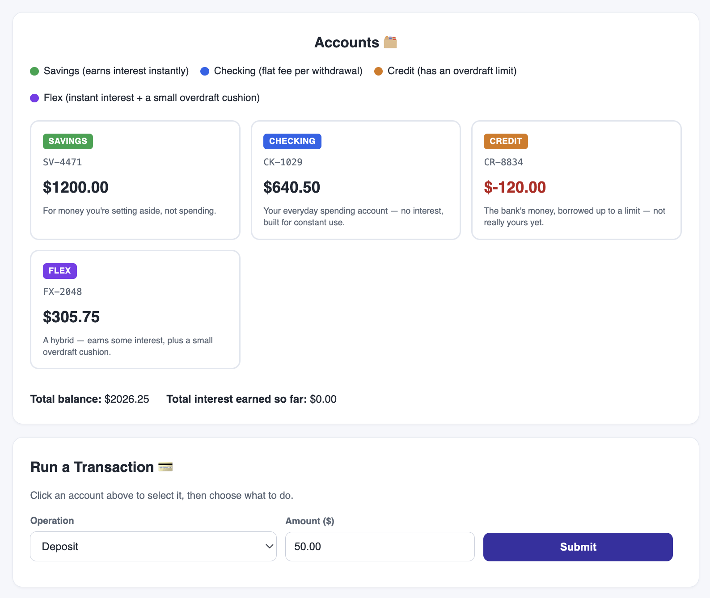

# 🏦 Personal Bank Management System (World Bank)



A fully interactive, console-based banking simulation built with Python.  
The project models realistic account operations while showcasing OOP, custom exceptions, iterators, generators, higher-order functions, and clean CLI interaction.

## ✨ Features

- **Interactive CLI workflow** with guided account and transaction prompts.
- **Four account types**:
  - `SavingsAccount` (deposit interest)
  - `CheckingAccount` (withdrawal fee)
  - `CreditAccount` (credit limit support)
  - `FlexAccount` (savings interest + overdraft behavior)
- **Transaction support** for deposit, withdrawal, and account-to-account transfer.
- **Per-transaction ledger entries** with timestamps, references, and running balances.
- **Ticket-style transaction output** showing balance before/after and detailed activity lines.
- **Domain-specific error handling** (`InvalidAmountError`, `InsufficientFundsError`, `BankError`).
- **Live account summaries and totals**, including total balance and earned interest.

## 🧠 Concepts Demonstrated

- Object-Oriented Programming (inheritance, mixins, class methods, properties)
- Custom exception design
- Iterators and generators
- Functional constructs (`reduce`, higher-order functions, lambdas)

## 🚀 Tech Stack

- **Language:** Python 3.x
- **Runtime:** Standard Python interpreter (no external dependencies)

## 🛠️ Getting Started

1. Clone the repository:
   ```bash
   git clone https://github.com/deepak4728/Personal-Bank-Management-System.git
   ```
2. Navigate to the project directory:
   ```bash
   cd Personal-Bank-Management-System
   ```
3. Run the application:
   ```bash
   python main.py
   ```
